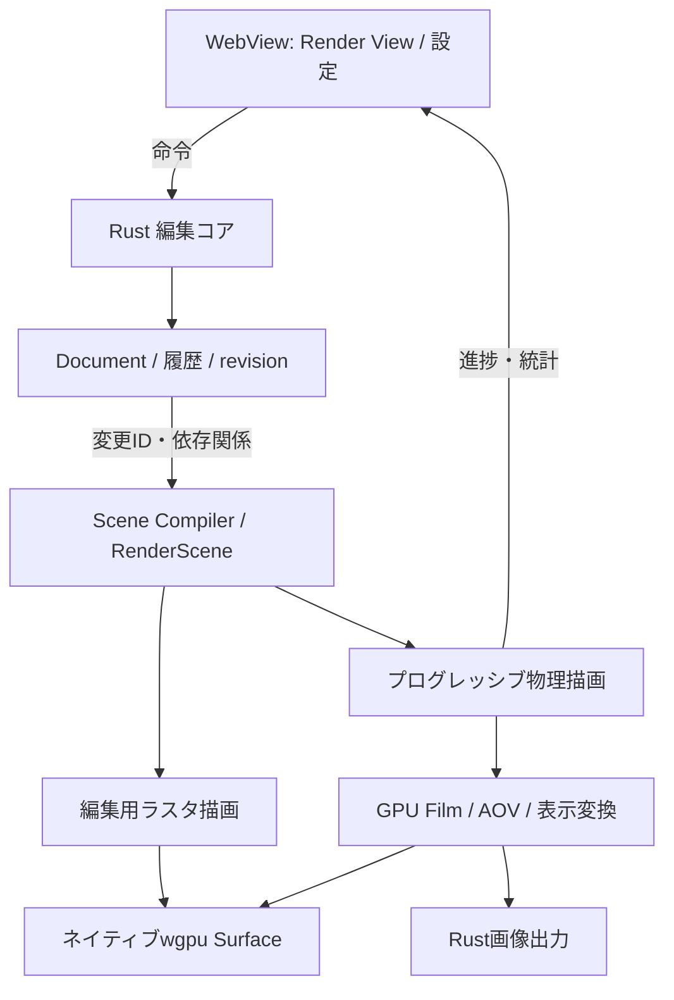

# Universal Renderer設計

設計日: 2026-10-22。進捗の正本は[ROADMAP](../ROADMAP.md)。この文書は未実装機能の設計であり、商用レンダラーとの品質・速度・互換性の同等性を保証するものではない。

## 目標と参照方針

編集の応答性を保ったまま、材質と照明を調整し、同じシーンから再現可能な最終画像を出せるレンダラーを作る。名称は仮称。公開資料の設計思想を参考に独立実装し、各製品のコード・シェーダー・UI素材は流用しない。ThreeXシンボリックリンクや商用SDKに依存しない。

| 参考にする製品 | 公式資料から読み取れる長所 | 本アプリでの採用方針 | 適用段階 |
| --- | --- | --- | --- |
| RenderMan | 層状マテリアル、光路別の出力、制作向けの拡張性 | 材質の評価・サンプリングを共通契約にし、層状BSDFと光路分類を後から追加できる設計。高度な表現は機能単位で検証 | R0・R3・R4 |
| Arnold | 光輸送のサンプリングを軸にした画質・ノイズの管理 | 小規模CPU参照とGPUの物理モデルを合わせ、少数の品質設定、非デノイズ画像、誤差計測で結果を判断 | R0・R1・R2 |
| V-Ray | LightMix、Render Elements、多数光源への適応 | ライトグループ別の線形寄与を保持し、照明比較・AOV出力・多数光源の選択を段階導入 | R2・R3・R4 |
| Redshift | GPUでの対話的な描画、テクスチャ／形状のout-of-core処理 | 小分けGPU実行とメモリ予算を先に整備し、テクスチャ、形状の順でページングを追加 | R1・R2・R3 |

参照: [RenderManのマテリアル](https://renderman.pixar.com/fundamentals-materials)、[RenderManの制作アーキテクチャ論文](https://graphics.pixar.com/library/RendermanTog2018/paper.pdf)、[Arnoldのサンプリング](https://help.autodesk.com/cloudhelp/ENU/AR-Core/files/ac-rendering/arnold_user_guide_ac_rendering_ac_what_sampling_html.html)、[V-Ray for Maya機能](https://www.chaos.com/vray/maya/features)、[Redshift](https://www.maxon.net/en/redshift)、[Redshiftメモリ設計](https://help.maxon.net/c4d/s26/en-us/Content/_REDSHIFT_/html/Memory.html)。最後の資料は旧版の設計説明として参照し、現在の製品の制約値には用いない。

以下の構成・優先順位・合格条件は本プロジェクト独自の提案である。複数エンジンの機能を丸ごと併合するのではなく、品質・操作性・実装コストが両立する部分から統合する。

## 現状と設計境界

2026-10-23時点ではOpenUSDの静止ポリゴン取り込みも追加済み（[対応範囲](openusd.md)）。現在は`renderer.rs`／`scene.wgsl`のプリミティブ・静止メッシュ用ラスタ描画、インスタンス共有、Transform差分更新がある。物理マテリアル、文書内のライト、パストレーシング、AOV、デノイズは未実装。既存カメラ操作とギズモを維持し、物理描画を独立した描画経路として追加する。

RustがDocument、評価済みシーン、描画ジョブ、GPU資源を所有する。WebViewはコマンド、設定、進捗、軽量な統計だけを扱う。フレーム、AOV、頂点列をJavaScriptへ毎フレーム転送しない。画像保存のGPU readbackはRust内の出力処理に限定する。

### 状態・モジュールの責務

| 構成案 | 責務と契約 |
| --- | --- |
| Document | `MaterialId`、`LightId`、`CameraId`、材質割当、レンダー設定を保存。永続IDをGPUスロット番号と分離する。編集は共通コマンド・Undo／Redo・差分通知を通す |
| Scene Compiler | 文書revisionと評価結果から`RenderScene`を作る。形状・材質・テクスチャは不変資源として共有し、ジョブごとの全シーン複製を避ける。将来のModifier依存グラフへ接続する |
| RenderScene | Mesh／Instance／Material／Light／Cameraの描画向け配列とID対応、資源ハッシュを保持。編集UIの構造に依存しない |
| RenderSession | `session_id`、`generation`、シーンrevision、品質設定、乱数seed、停止条件を保持。表示中のIPRと固定スナップショットの最終ジョブを区別する |
| Integrator / Film | 光路をサンプリングし、線形HDR・サンプル数・分散・AOVを累積。表示変換とデノイズを別処理にする |
| Resource Manager | デバイス上限とアプリ予算からGPU資源、CPUキャッシュ、転送キューを管理。失敗・再試行・キャンセルをセッションへ返す |
| Render View | 共有セッションを表示するドック／フローティングパネル。ウインドウ自身はDocumentや別のレンダー状態を所有しない |

既存ファイルの一括置換は行わず、`render_scene`、`render_session`、`integrator`、`film`等へ必要な境界から切り出す。名称は実装時に調整する。

## 共通の画質モデル

R0で距離の単位、光源強度の単位、カメラ露出、テクスチャの色／データ区分を固定する。既存ファイルは従来の見た目を確認しながら既定値で移行し、将来の形式バージョンと移行テストを追加する。現在のv1読込・v2保存の互換性を不用意に壊さない。

R1はscene-linear RGBで計算し、作業色空間の識別子を文書・出力に記録する。色テクスチャは入力変換し、法線・粗さなどのデータには色変換を適用しない。累積・AOV・ライト再合成を線形空間で行い、露出と表示変換を最後に適用する。R4でOpenColorIO／ACESを導入する際は、既存の色管理を明示的に移行する。

最初の積分器は拡散・粗い金属のBSDF、面光源とHDR環境の重要度サンプリング、直接光サンプリングとBSDFサンプリングのMIS、間接光、Russian rouletteを備える。BSDFは評価値・確率密度・生成方向の整合性とエネルギー保存を検証する。最大反射回数や近似による差を記録し、「完全に不偏」とは表示しない。

| モード | 用途 | 品質の扱い |
| --- | --- | --- |
| 編集 | 常時のモデリング・選択・ギズモ | 現行ラスタを継続し、物理描画との見た目の差を許容する |
| Interactive | IPRでの材質・照明調整 | 同じ物理コアで解像度・時間予算を調整。デノイズ、クランプ等を使う場合は有効状態を表示する |
| Final | 保存・比較・制作出力 | 固定シーンと設定で収束。非デノイズHDRを保持し、時間／サンプル上限による終了を品質達成と混同しない |
| Reference | 自動検証・不具合切分け | 小さなシーン、固定サンプル数、クランプ・デノイズなし。CPUとGPUを統計的に比較する |

## シーン更新と応答性

形状ごとのBLASとインスタンスのTLASを分け、既存の形状共有を利用する。最初はRustでBVHを構築し、wgpu computeで探索する。TransformはTLASのrefit、トポロジ変更は対象BLAS再構築を基本とし、refitで探索効率が悪化したら再構築する。負スケール・ミラー・シアーを含む逆変換、法線変換、面の向きを検証する。

| 変更 | GPU資源更新 | 物理描画の累積 |
| --- | --- | --- |
| Transform・可視性・追加／削除 | 対象インスタンス、関連する加速構造 | GIへの影響があるため原則全リセット |
| 形状・材質・ライト・環境 | 変更資源と依存先 | 原則全リセット |
| カメラ・解像度・積分器設定 | 対象設定、必要に応じFilm再確保 | 全リセット |
| 表示露出・表示変換 | 表示用設定 | 線形HDRを再表示し、累積継続 |
| ライトグループの表示倍率 | 合成用設定 | 条件を満たす既存AOVから再合成 |
| 選択・ギズモ・パネル配置 | UI／オーバーレイのみ | リセットしない |

GPUへの差分転送と、光輸送の累積無効化は別の判断とする。物体の変更範囲だけを描き直して間接光が正しく更新される、という前提を置かない。

GPU実行を短いタイル／サンプル単位に分け、編集ラスタと入力応答に実行時間を残す。ドラッグ中は低解像度IPRまたはラスタ表示とし、操作完了後に新generationで収束させる。世代の異なる計算結果は表示・出力へ混入させない。Documentロックを保持したままGPU完了やディスクI/Oを待たない。

最終ジョブは開始時の固定スナップショットを使い、その後の編集と分離する。停止はサンプル境界で受け付け、再開可能かを状態に明示する。再開は同一シーン・設定・資源の検証が通る場合に限る。

## 照明・合成・材質の拡張

R2ではBeauty、Albedo、Normal、Depth、サンプル数／分散、限定数のライトグループを先行する。AOVの定義、背景、透明度、線形合成、単位を固定してから種類を増やす。ライトグループは直接光だけでなく、その光源に由来する間接寄与も追跡する。

ライト再合成は、同じ形状・材質・光源位置・光源分布で、保存済み寄与の強度／RGB倍率だけを変える範囲に限定する。ゼロ強度で未サンプリングの光、新しい光、位置・面積・影の変更は再レンダーする。大幅な増光はノイズも増幅するため品質を再評価する。結果を実際のライト設定へ適用するときは1回のUndo可能な文書編集にする。

R3は透過・コートから始め、層状材質、SSS、ヘア、ボリュームを別の合格ゲートで追加する。Lamaそのものの互換実装は前提にしない。材質の中間表現からWGSLへ変換し、未対応ノードやローブを黙って別の外観に置き換えない。MaterialX／OpenPBRはR4で対応ノード・バージョン・変換損失を明記する。任意OSL実行は初期範囲外とし、必要になった時点で別途設計する。

多数光源の選択はR1の単純な分布を基準に比較し、R3で階層化・適応化する。複雑なコースティクス、スペクトル描画、双方向積分器、Deep出力は初期範囲外とし、実制作での需要と参照テストを確認してから追加判断する。

## GPUとメモリ

最初の必須経路はwgpu computeとソフトウェアBVHとする。ハードウェアRTは、使用するwgpu版・バックエンド・アダプターの対応と実機品質を確認できた場合の追加経路とし、CUDA／OptiXを必須依存にしない。共有メモリのMacでも無制限に確保できるとは扱わない。

R1からFilm、BVH、形状、テクスチャ、作業キューの見積りと上限を設ける。確保失敗時はタイル縮小・同時実行数削減・安全な停止を行い、Documentとラスタ編集を保持する。自動的に最終画像の材質や解像度を変えて完了扱いにしない。

R3のout-of-coreはテクスチャから開始する。CPU側キャッシュ、mip／タイル単位の転送、予算付き退避と先読みを設計する。欠損ページを黒として最終累積に加えず、必要資源が届くまで該当サンプルを保留・再実行する。対話用の低解像度代替は近似表示として分離する。ジオメトリのページングは加速構造の常駐範囲・非同期ロード・再探索を検証した後に追加する。RAMやディスク転送で速度が低下し得るため、容量拡張と高速化を同一視しない。

デノイズは任意の後処理。非デノイズ結果を保持し、デノイザーの可用性にレンダラー全体を依存させない。実装候補は対応GPU、品質、配布条件、転送費用を比較して決める。

RenderManのCPU／GPU協調は[公開されている設計](https://prod.renderman.pixar.com/about)を参考にするが、同時利用を初期必須にしない。[XPUの機能差](https://renderman.atlassian.net/wiki/spaces/REN28/pages/1390240257/XPU%2BFeatures%2Band%2BLimitations)も踏まえ、本アプリも機能対応表を持つ。R0のCPU参照実装は検証用であり、商用品質のCPUフォールバックではない。R4の複数GPU／CPU協調は、転送・シーン複製・メモリ費用を含めて単一GPUより有益な場合だけ採用する。

## Mayaに近い制作操作

中央パネルに編集／IPR表示切替、別のRender Viewに開始・停止・領域・比較・保存を配置する。Render Viewは既存パネル機構に接続し、自由ドッキングはその基盤の進捗に合わせる。画像はネイティブGPU表示し、複数ウインドウは同じセッションを参照する。

常設UIはアイコン中心で、サンプル数・経過時間・進捗・メモリ不足など判断に必要な状態を短く表示する。詳細は情報アイコンのhover／focusへ置き、英語・日本語・简体中文を同時に用意する。狭いパネルではツールをまとめ、意味のない途中改行を避ける。

Escapeは入力コンテキストで解釈する。ギズモ操作中は既存の編集取消を優先し、Render Viewの実行操作中は対象ジョブを停止する。ジョブ停止でDocumentの編集を巻き戻さない。材質・照明・保存対象設定の変更はUndo／Redo可能とし、サンプル進捗や一時的な比較表示は文書履歴に入れない。

## 実装ゲートと検証

| 段階 | 次へ進む条件 |
| --- | --- |
| R0 | 文書移行・ID参照・不正入力・Undo／Redo・複数ビュー通知がテスト可能。単位・色・乱数・評価指標を確定。小規模CPU参照で既知の照明条件を検証 |
| R1 | 拡散室、金属、面光源、HDR環境、ミラー／負スケール／シアー、遮蔽と間接光のシーンが描画できる。CPU／GPUの統計比較、カメラ移動後の残像排除、取消、リサイズ、保存を通す |
| R2 | 同一ハードウェア・シーン・解像度で画質到達時間を比較。ライトグループ再合成の一致、AOVの定義、デノイズ前後の欠損を確認。速度改善で画質が下がっていないことを示す |
| R3 | 材質／形状機能ごとに参照画像を追加。大量インスタンス・多数光源・メモリ上限超過を試し、停止・ページング・復旧時に画像と文書が破損しない |
| R4 | 色管理と交換形式の往復・未対応項目の報告、EXR読み戻し、チェックポイント整合性、バッチ再実行を確認。対応GPU／OSごとに実機結果を記録 |

画像比較は固定seedだけの完全一致に頼らず、複数seedと高サンプル参照を用い、線形HDRの誤差・輝度の偏り・収束を調べる。R0で試験シーンごとの許容差を先に決める。インスタンスは既存の上限を踏まえた1万体の場面も含める。速度はサンプル毎秒に加え、同等誤差までの時間、編集後の初回表示、入力応答のp95、GPU／CPUメモリ、差分転送量を記録する。

初期の応答目標案は、対象Mac・固定シーン・解像度を明記したうえで、入力応答p95が100ms以内、編集終了から最初の新しいIPR結果まで500ms以内とする。これは未計測の設計目標であり、達成済みの性能ではない。超過時は対話用解像度／バッチ量の調整を優先し、最終品質を暗黙に変えない。

初回の実装単位はR0の「材質・面光源・レンダーカメラ・設定の文書契約、移行と履歴、検証シーン」に絞る。続いて同じプリミティブをCPU参照とGPUで描画するR1へ進み、ノードエディタや高度な材質を先に作り込まない。
